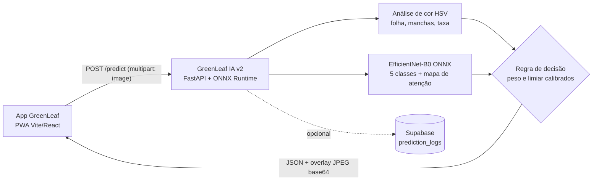

# Integração da GreenLeaf IA v2 ao app GreenLeaf

Este guia explica como a API v2 (pasta `backend/`) se conecta ao app **Greenleaf-Mobile** e o que muda (pouco) no app.

## 1. Arquitetura



- O app **continua chamando o mesmo endereço** (`VITE_API_URL`) e as mesmas rotas: `POST /predict`, `GET /health`, `GET /metrics`.
- Sai o TensorFlow, entra o **ONNX Runtime**: a imagem Docker fica bem menor, o servidor sobe mais rápido na Render
  (plano gratuito "dorme") e cada análise leva ~0,2 s de CPU num PC (cerca de 2 s no plano gratuito da Render).

## 2. Contrato da API (compatível com o app atual)

`POST /predict` — `multipart/form-data`, campo `image` (JPEG ou PNG, até 8 MB).

| Campo | Tipo | Significado |
|---|---|---|
| `probability` | 0–1 | Chance de bacteriose: `peso × rede + (1 − peso) × cor`, peso calibrado na validação (hoje 1,0, ou seja, só a rede). `Infectado` a partir de 0,28 (limiar que equilibra alarmes falsos e bacterioses perdidas, F1) |
| `model_probability` | 0–1 ou `null` | Probabilidade de bacteriose (CBB) dada pela rede; `null` = modelo não carregou, só cor |
| `hsv_probability` | 0–1 | Probabilidade pela cor (`min(taxa / 0,20, 1)`) |
| `class` | `"Infectado"` \| `"Saudavel"` | Decisão sobre **bacteriose** |
| `ratio` | 0–1 | Taxa de infecção: parte da folha analisada com necrose (marrom, escuro, acinzentado). Amarelo não conta. **0 quando não é bacteriose** |
| `severity` | `"Leve"` \| `"Moderada"` \| `"Grave"` | Pela taxa: < 3 %, < 15 %, ≥ 15 % (o app ignora quando `Saudavel`) |
| `processing_time_ms` | número | Tempo no servidor |
| `overlay` | `data:image/jpeg;base64,...` | Folha em verde, manchas em vermelho **só quando o diagnóstico é bacteriose**, **contorno amarelo = onde a IA olhou** |
| **novos (opcionais)** | | |
| `other_disease` | `"CBSD"` \| `"CGM"` \| `"CMD"` \| `null` | Bacteriose descartada, mas a folha tem sinais de outra doença |
| `diagnosis` | `{code, label, probability}` | Classe mais provável entre as 5 |
| `class_probabilities` | `{CBB, CBSD, CGM, CMD, Healthy}` | Probabilidades das 5 classes |
| `model_version` | texto | Versão do modelo (vai para o histórico) |

Erros: `400` formato inválido/arquivo corrompido, `413` maior que 8 MB, `422` foto pequena (< 160 px), escura ou estourada.
O app já trata os três (`invalid_image`, `too_large`).

> O zod do app (`predictionResultSchema`) ignora campos que não conhece, então **o app atual funciona com o servidor v2 sem
> nenhuma mudança**. As mudanças abaixo só servem para mostrar as informações novas.

## 3. Mudanças no app (branch `feat/ia-v2` do [Greenleaf-Mobile](https://github.com/Yajoojj/Greenleaf-Mobile))

| Arquivo | O que muda |
|---|---|
| `src/domain/types.ts` | `PredictionResult` ganha `other_disease?` e `model_version?`; `Analysis` ganha `otherDisease?` e `modelVersion?` |
| `src/domain/schemas.ts` | Valida os dois campos novos como **opcionais** (servidor antigo, mock e demonstração continuam válidos) |
| `src/domain/Diagnosis.ts` | `Diagnosis.otherDisease`; `isHealthy` passa a ser falso quando há outra doença |
| `src/domain/AnalysisBuilder.ts` | Copia `otherDisease` e `modelVersion` para o histórico |
| `src/pages/parts/DiagnosisView.tsx` | Selo "Sem bacteriose" + cartão "Possível outra doença" + textos próprios; versão do modelo nos detalhes |
| `src/ui/components/DiagnosisBadge.tsx`, `HistoryItem.tsx` | Selo "Sem bacteriose" também no histórico |
| `src/ui/components/ImageCompare.tsx` | Legenda "Onde a IA olhou" (contorno amarelo) quando o resultado veio do modelo v2 |
| `src/i18n/pt-BR.ts`, `en.ts` | Textos novos nos dois idiomas |
| testes | `Diagnosis.test.ts`, `schemas.test.ts`, `pages.test.tsx` (inclui checagem de acessibilidade com axe) |

**Por que "Sem bacteriose" e não "Sadia":** o modelo antigo só sabia "infectado x sadio" e a análise de cor marcava qualquer
amarelado. Uma folha com mosaico (CMD, 61 % das fotos do Kaggle) era anunciada como bacteriose ou como sadia. O v2 separa as
5 classes; se a folha tem mosaico, o app diz que **não é bacteriose** mas **não está sadia**, e orienta procurar um técnico.

## 4. Rodar tudo localmente

API (pasta `backend/`):

```bash
python -m venv .venv
.venv/Scripts/pip install -r requirements-dev.txt
.venv/Scripts/python -m uvicorn app.main:app --port 8000
```

App (pasta do Greenleaf-Mobile), com `.env.local` contendo `VITE_API_URL=http://localhost:8000`:

```bash
npm run dev
```

O CORS do servidor já libera `http://localhost:5173` e `http://localhost:4173` por padrão.

## 5. Publicar na Render

1. A pasta `backend/` já contém `models/greenleaf_effb0.onnx` e `models/greenleaf_effb0.json`.
2. Na Render: **New → Web Service → Docker**, *Root Directory* `backend/`.
3. Variáveis de ambiente: `APP_ENV=production`, `CORS_ORIGINS=https://<domínio-do-app>`. Não defina
   `CONFIDENCE_THRESHOLD`/`MODEL_WEIGHT` a não ser que queira sobrescrever os valores calibrados.
4. No app, `VITE_API_URL=https://<servico>.onrender.com`.
5. Confira `GET /health`: `model_loaded: true` e `model_version` preenchido.

## 6. Rodar a IA no próprio celular (futuro, sem internet)

O mesmo arquivo `greenleaf_effb0.onnx` roda no navegador com `onnxruntime-web` (WebAssembly), o que atende ao trabalho
futuro "execução em dispositivo" do artigo. Passos: servir o `.onnx` pelo service worker (precache), redimensionar a foto
para o tamanho de `img_size` do `.json`, montar um `Float32Array` `[1,3,S,S]` com valores 0–1 e ler a saída `probs`.
A análise de cor já existe no app (`src/services/colorAnalysis.ts`). Esse modo não foi implementado neste ciclo.
