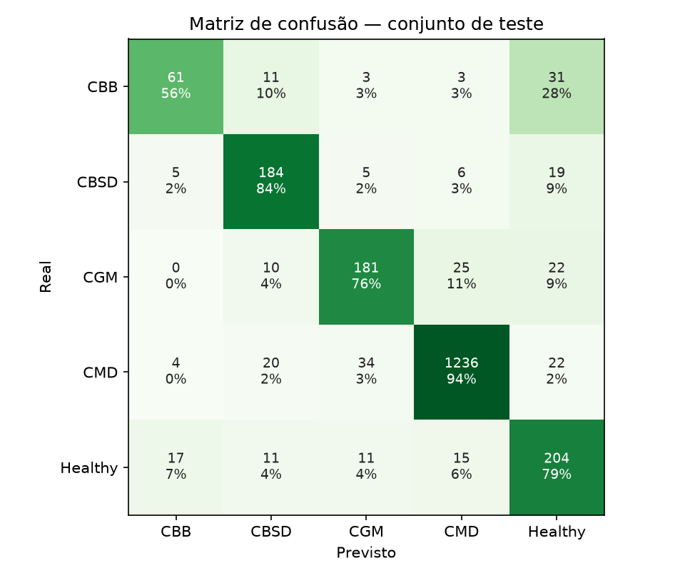

# Resultados — GreenLeaf IA

Modelo `greenleaf_effb0_384-2026-10-29`, conjunto de **teste** com 2140 fotos do Kaggle nunca usadas no treino nem na calibração (divisão estratificada 80/10/10, semente 42). Medido com o mesmo código do servidor.

## Classificação das 5 classes

| Classe | Precisão | Revocação | F1 | Fotos |
|---|---|---|---|---|
| Bacteriose (CBB) | 70.1% | 56.0% | 62.2% | 109 |
| Estria marrom (CBSD) | 78.0% | 84.0% | 80.9% | 219 |
| Mosqueado verde (CGM) | 77.4% | 76.1% | 76.7% | 238 |
| Mosaico (CMD) | 96.2% | 93.9% | 95.0% | 1316 |
| Sadia | 68.5% | 79.1% | 73.4% | 258 |
| **Acurácia global** | | | **87.2%** | |
| **F1 macro** | | | **77.6%** | |

## Bacteriose sim/não (o que o app mostra)

Regra: `probabilidade = 1.0 × P(CBB) + 0.00 × prob. pela cor`, bacteriose se ≥ **0.28** (escolhido por F1 na validação).

| Métrica | GreenLeaf (rede + cor) | Só cor, sem rede |
|---|---|---|
| Revocação (bacterioses encontradas) | 64.2% | 45.9% |
| Precisão (alarmes corretos) | 61.4% | 5.5% |
| Especificidade (não-bacterioses descartadas) | 97.8% | 57.6% |
| F1 | 62.8% | 9.8% |
| Acurácia | 96.1% | 57.0% |
| AUC ROC | 93.1% | 50.3% |
| Verdadeiros positivos / falsos negativos | 70 / 39 | 50 / 59 |
| Falsos positivos / verdadeiros negativos | 44 / 1987 | 861 / 1170 |

Tempo médio por foto em CPU (rede + cor, sem rede de celular): **215 ms**.

A severidade (Leve/Moderada/Grave) vem da taxa de manchas medida pela cor; o dataset não tem rótulo de severidade,
então ela não entra nestas métricas.
